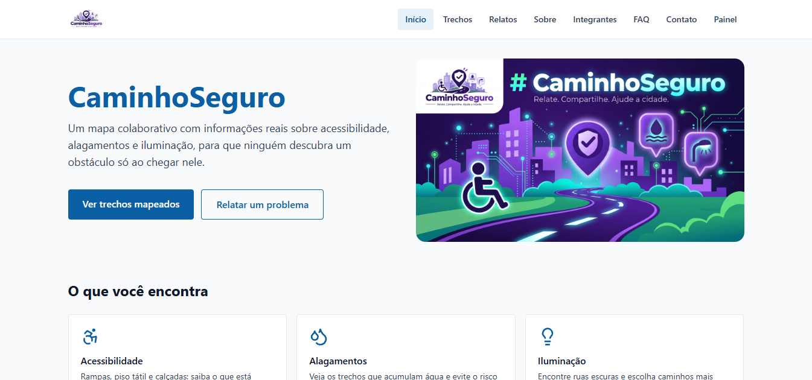
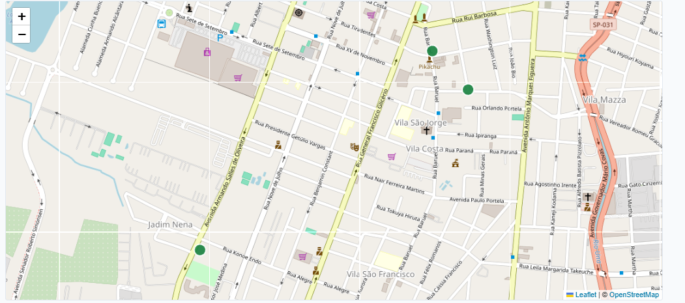
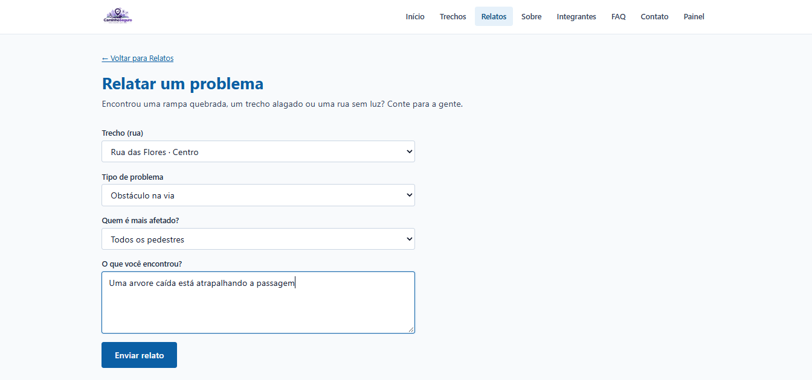
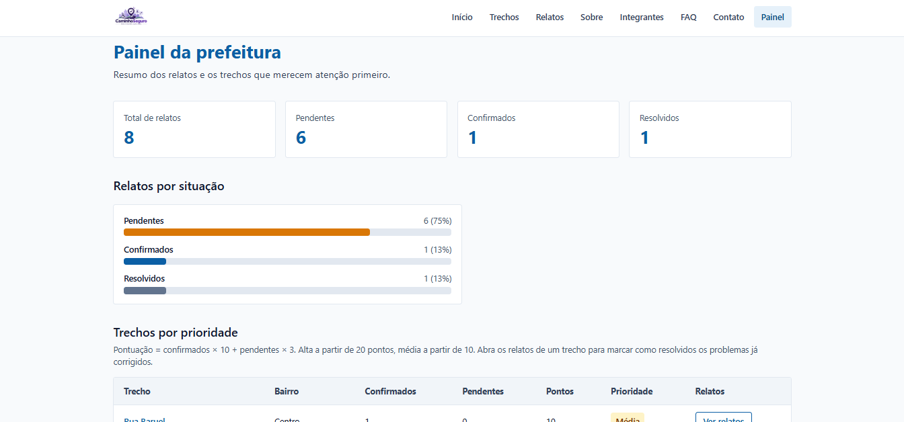

#  CaminhoSeguro

Plataforma colaborativa em que o cidadão relata problemas de acessibilidade, alagamento e iluminação por trecho de rua, e a prefeitura recebe um painel de prioridades para agir primeiro onde mais importa.

> Desenvolvido para a **Global Solution 2026/2 · CitizenTech · FIAP** — 1º ano de Análise e Desenvolvimento de Sistemas (turma 1TDSPJ), disciplina de Front-End Design Engineering.

---

## Sobre o projeto

Quem tem mobilidade reduzida costuma descobrir que um local é inacessível só ao chegar nele, e quem anda a pé não sabe quais trechos alagam ou são mal iluminados. As informações existem, mas estão dispersas. O **CaminhoSeguro** reúne tudo num só lugar: o cidadão relata, outras pessoas confirmam e a prefeitura enxerga onde agir primeiro.

Cada trecho de rua recebe uma **nota de acessibilidade de 0 a 100**, calculada a partir dos relatos:

```
nota = 100 − (20 × relatos confirmados) − (5 × relatos pendentes)
```

- **Boa:** 80 a 100 · **Atenção:** 50 a 79 · **Crítica:** 0 a 49
- Um relato nasce **Pendente** e vira **Confirmado** quando 3 pessoas relatam o mesmo problema.
- Ninguém precisa criar conta: cada navegador recebe um código anônimo, que impede a mesma pessoa de confirmar o mesmo relato duas vezes.

Nesta etapa, o front-end consome a **API REST em Java (Spring Boot)** publicada na nuvem, que persiste os dados em Oracle.

### 🌍 ODS relacionados

- **ODS 11** — Cidades e comunidades sustentáveis (principal)
- **ODS 10** — Redução das desigualdades
- **ODS 13** — Ação contra a mudança global do clima

---

## ✨ Funcionalidades

- Lista de trechos com nota, classificação e busca, em modo **lista** ou **mapa**
- Detalhe do trecho com mini mapa e os relatos dele
- Cadastro de trecho, com escolha do ponto clicando no mapa
- Cadastro de relato com validação de formulário
- Confirmação de relatos de outras pessoas
- Lista de relatos com filtros por situação, perfil afetado e texto
- Painel da prefeitura com totais, gráfico e trechos por prioridade
- Páginas institucionais: Início, Sobre, Perguntas frequentes, Integrantes e Contato
- Estados de carregamento, erro (com "Tentar novamente") e ausência de dados
- Interface responsiva em celular, tablet e desktop

---

## Páginas e rotas

| Rota | Página |
|---|---|
| `/` | Início |
| `/sobre` | Sobre o projeto |
| `/faq` | Perguntas frequentes |
| `/integrantes` | Integrantes |
| `/contato` | Contato (formulário validado) |
| `/trechos` | Lista de trechos (lista ou mapa) |
| `/trechos/novo` | Cadastro de trecho |
| `/trechos/:id` | Detalhe do trecho (**rota dinâmica**) |
| `/relatos` | Lista de relatos com filtros |
| `/relatos/novo` | Cadastro de relato |
| `/painel` | Painel da prefeitura |

---

## 🛠️ Tecnologias utilizadas

           

Consumo da API com **Fetch API** (sem bibliotecas externas de requisição), validação de formulários com **React Hook Form**, ícones com **lucide-react**, análise de código com **oxlint** e versionamento com **Git Flow**. A API foi desenvolvida em  com banco .

---

##  Integração com a API

URL base definida em `VITE_API_URL`. Endpoints usados pelo front:

| Método | Rota | Uso |
|---|---|---|
| GET | `/trechos` | Listar trechos |
| GET | `/trechos/{id}` | Detalhe do trecho |
| POST | `/trechos` | Cadastrar trecho |
| GET | `/trechos/{id}/relatos` | Relatos de um trecho |
| POST | `/trechos/{id}/relatos` | Cadastrar relato |
| GET | `/relatos?status=&perfil=&busca=` | Listar relatos com filtros |
| POST | `/relatos/{id}/confirmacoes` | Confirmar um relato |
| GET | `/painel` | Resumo e prioridades |

Todas as chamadas ficam em `src/services/api.ts`, tipadas com as interfaces de `src/types/index.ts`.

---

## 📁 Estrutura de pastas

```
caminhoseguro-front/
├── docs/screenshots/        # capturas de tela do README
├── src/
│   ├── components/          # componentes reutilizáveis (uma pasta por componente)
│   │   ├── Cabecalho/
│   │   ├── Menu/
│   │   ├── Rodape/
│   │   ├── Carregando/
│   │   ├── MensagemErro/
│   │   ├── MensagemVazia/
│   │   ├── CardTrecho/
│   │   ├── CardRelato/
│   │   ├── CampoFormulario/
│   │   ├── MapaTrechos/
│   │   └── ...
│   ├── hooks/               # hooks personalizados (useConfirmarRelato, useResolverRelato)
│   ├── pages/
│   │   ├── Home/
│   │   ├── Sobre/
│   │   ├── Faq/
│   │   ├── Integrantes/
│   │   ├── Contato/
│   │   ├── Trechos/
│   │   ├── TrechoDetalhe/
│   │   ├── NovoTrecho/
│   │   ├── Relatos/
│   │   ├── NovoRelato/
│   │   ├── Painel/
│   │   └── NaoEncontrada/
│   ├── routes/AppRoutes.tsx
│   ├── services/            # chamadas à API (fetch)
│   ├── types/               # interfaces e tipos TypeScript
│   ├── utils/               # funções auxiliares e rótulos
│   ├── assets/imagens/      # logo, banners e fotos dos integrantes
│   ├── App.tsx
│   └── main.tsx
├── .env.example
├── .oxlintrc.json
├── index.html
├── package.json
├── vercel.json
└── vite.config.ts
```

---

## 👥 Autores e créditos

| Foto | Nome | RM | Turma | Links |
|---|---|---|---|---|
|  | Sabrina Fraga Lima | 572548 | 1TDSPJ | [GitHub](https://github.com/sabrinafraga) · [LinkedIn](https://www.linkedin.com/in/sabrina-fraga-562777403/) |
|  | Tailyni Victoria Renovato Satirio | 570517 | 1TDSPJ | [GitHub](https://github.com/TailyniDev) · [LinkedIn](https://www.linkedin.com/in/tailynisatiriodev/) |
|  | Gabriel Tadeu Telles Brando | 571074 | 1TDSPJ | [GitHub](https://github.com/Tadeul) · [LinkedIn](https://www.linkedin.com/in/gabriel-tadeu-telles-brando-330216337/) |

---

## 🖼️ Imagens do projeto






---

## ▶️ Como usar

### Links do projeto

- 🔗 **Repositório GitHub:** https://github.com/TailyniDev/caminhoseguro-front
- 🌐 **Deploy (Vercel):** https://caminhoseguro-front.vercel.app
- 🎥 **Vídeo de apresentação (YouTube):** https://youtu.be/Qa6nexLXHr0
- ⚙️ **API publicada (Render):** https://caminhoseguro-api.onrender.com
- 📦 **Repositório da API:** https://github.com/Tadeul/caminhoseguro-api

> ⏳ A API roda no plano gratuito do Render e "hiberna" após alguns minutos sem uso. A primeira requisição pode levar cerca de 1 minuto.

### Rodando localmente

**Pré-requisito:** Node.js 20.19 ou superior (confira com `node -v`).

```bash
# clone o repositório
git clone https://github.com/TailyniDev/caminhoseguro-front

# entre na pasta do projeto
cd caminhoseguro-front

# instale as dependências
npm install

# crie o arquivo de variáveis de ambiente
cp .env.example .env.local   # no Windows: copy .env.example .env.local

# rode o projeto
npm run dev
```

O projeto ficará disponível em `http://localhost:5173`.

### Variáveis de ambiente

| Variável | Descrição | Exemplo |
|---|---|---|
| `VITE_API_URL` | URL base da API, sem barra no final | `https://caminhoseguro-api.onrender.com` |

Depois de alterar o `.env.local`, reinicie o `npm run dev`. Na Vercel, a mesma variável é configurada em *Settings → Environment Variables*, e o projeto precisa ser republicado.

### Scripts

| Comando | O que faz |
|---|---|
| `npm run dev` | Servidor de desenvolvimento |
| `npm run build` | Verifica os tipos e gera o build de produção em `dist/` |
| `npm run preview` | Serve o build localmente |
| `npm run lint` | Análise do código com oxlint |

---

## 📋 Requisitos da disciplina atendidos

<details>
<summary>Ver quadro de requisitos</summary>

| Requisito | Onde está |
|---|---|
| React + Vite + TypeScript | Todo o projeto, com código próprio em `.ts` e `.tsx` |
| Estrutura de pastas e tipagem | `src/` organizado por responsabilidade; interfaces em `src/types` |
| Componentes reutilizáveis | `CardTrecho`, `CardRelato`, `CampoFormulario`, `Carregando`, `MensagemErro`, `MensagemVazia`, `TituloPagina`, entre outros |
| 5 páginas institucionais | Início, Sobre, Perguntas frequentes, Integrantes e Contato |
| Páginas da solução | Trechos, Detalhe do trecho, Relatos, Novo relato, Novo trecho e Painel |
| Rotas estáticas e dinâmica | `src/routes/AppRoutes.tsx`; rota `/trechos/:id` |
| Tailwind CSS e responsividade | Testado em 390×844, 768×1024 e 1440×900 |
| Consulta GET à API Java | Trechos, relatos e painel |
| Operações de escrita | POST de trecho, relato e confirmação |
| Camada de serviços | `src/services/api.ts` |
| Loading, erro e ausência de dados | Componentes `Carregando`, `MensagemErro` e `MensagemVazia` |
| Formulários com validação | Contato, Novo relato e Novo trecho (React Hook Form) |
| Deploy na Vercel | Link na seção "Como usar" |
| GitHub com histórico de commits | Branches por funcionalidade, no padrão Git Flow |

</details>

---

## ♿ Acessibilidade

- Link "Pular para o conteúdo" no início de todas as páginas
- Menu de navegação com `aria-expanded` e rótulos nos botões
- Campos de formulário com `label`, erros anunciados (`role="alert"`) e `aria-invalid`
- A cor nunca é a única informação: notas e prioridades também aparecem em texto
- A visão em **lista** é uma alternativa completa ao mapa, para quem navega por teclado ou leitor de tela

---

## 🔀 Fluxo de Git

O projeto segue o **Git Flow**:

- `main`: versão estável, a que está publicada
- `develop`: integração das funcionalidades
- `feature/*`: uma branch por funcionalidade, mesclada na `develop` com `--no-ff`
- `release/*`: preparação da entrega

Padrão dos commits: `feat:` (funcionalidade), `fix:` (correção), `refactor:` (reorganização), `chore:` (configuração) e `docs:` (documentação).

---

## 🤖 Uso de IA generativa

Declaração conforme o regulamento da Global Solution.

- **Ferramenta:** Claude (Anthropic).
- **Para que foi usada:** Para ajudar as funcionalidades mais complexas do site, como a integração com uma API de mapa, e com melhorias no projeto
- **O que o grupo fez:** Nós fizemos toda a estrutura principal do código.

---

## 📬 Contato

- GitHub: [TailyniDev](https://github.com/TailyniDev) · [Tadeul](https://github.com/Tadeul) · [sabrinafraga](https://github.com/sabrinafraga)
- 🤝 Global Solution 2026/2 · CitizenTech · FIAP

---

© 2026 CaminhoSeguro
